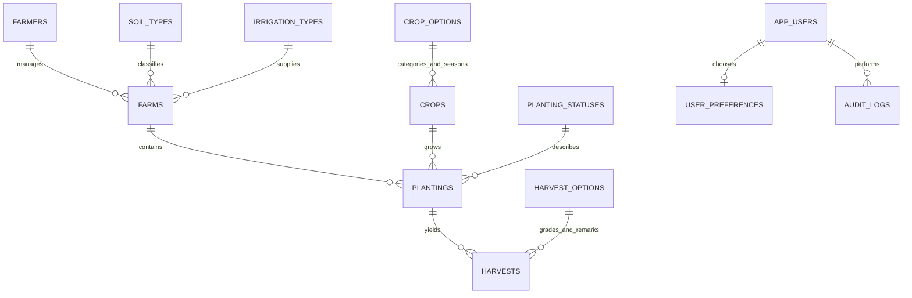

# Agriculture Information System Design and Requirements Map

## Scope and source comparison

The teacher's AP3 assignment is the governing source for the required five business tables, the exact 13-table count, Supabase PostgreSQL, the core modules, the 1-5 harvest remark IDs, dashboard, roles, validation, search, reports, pagination, deletion safeguards, responsive use, normalization evidence, and documentation deliverables. The Software Design Document (SDD) expands those requirements with PHP/PDO structure, audit behavior, detailed validation, access boundaries, reports, data freshness, a safe PWA, and deployment guidance.

| Topic               | Instructor assignment                                                                                  | SDD                                           | Implementation decision                                                                                                                          |
| ------------------- | ------------------------------------------------------------------------------------------------------ | --------------------------------------------- | ------------------------------------------------------------------------------------------------------------------------------------------------ |
| Table count         | Exactly 13 per project instruction                                                                     | Proposes 15                                   | Exactly 13; all tables serve a documented function.                                                                                              |
| Core modules/tables | Farmers, Farms, Crops, Planting, Harvest                                                               | Preserves the same five                       | All five tables and CRUD modules are present.                                                                                                    |
| Database            | Supabase PostgreSQL                                                                                    | Supabase PostgreSQL                           | PDO connects from server-side PHP; credentials never reach the browser.                                                                          |
| CSS                 | HTML/CSS/basic JavaScript; optional framework                                                          | Selects Tailwind                              | Local CSS and vanilla JavaScript avoid a build/CDN dependency while preserving the visual/responsive requirements.                               |
| Controlled values   | Separate lookup/reference data; descriptive labels, stored IDs                                         | Seven lookup tables                           | Typed crop and harvest lookup tables plus soil, irrigation, status tables. Composite foreign keys enforce the option type.                       |
| Roles               | Administrator and Staff; assignment says role-aware functions                                          | Separate role and user tables                 | Constrained `role` on `app_users`; only Administrators manage users/lookups and delete records.                                                  |
| Profile theme       | User asks for dark choice on Profile                                                                   | Does not specify profile theme                | `user_preferences` stores a real per-user theme preference.                                                                                      |
| Remark IDs          | Fixed: Good Harvest=1 through Damaged Harvest=5                                                        | Same mapping                                  | IDs 1-5 are seeded exactly; grade IDs use 101-103.                                                                                               |
| Planting/seed units | Field names only, no units shown                                                                       | Proposes ha/kg and flags as assumptions       | Keep source field names, display `ha*` / `kg*` and document the unresolved assumptions.                                                          |
| Currency            | No currency stated                                                                                     | Assumes PHP/kg and asks to confirm            | Report estimates are labeled estimates; confirm currency before formal use.                                                                      |
| PWA                 | Not required                                                                                           | Detailed installable PWA design               | Safe optional shell is included; only public static assets are cached.                                                                           |
| First admin         | User provides a named email and an initial password, which must be hashed and changed at first sign-in | SDD warns against hard-coded default accounts | One-time CLI setup consumes environment variables, hashes the password, and forces first-login change. No default password is written to source. |

The SDD examples are proposals, not evidence that the system already existed. The teacher's 13-table constraint takes precedence over the SDD's proposed count. The 13-table schema merges two related lookup pairs and embeds the two fixed roles as a check-constrained user field. The additional `user_preferences` table supports the requested Profile setting and avoids placing an optional user preference in a security account row.

The assignment's embedded sample screenshots were reviewed as well. They contain illustrative crop/farm/farmer/planting/harvest rows; some harvest remarks in the example rows do not use the teacher's separate five-value reference mapping. Those screenshots are sample data, not a replacement for the explicit controlled-remark requirement. Their personal-looking farmer contact values are not copied into the implementation or migration.

## Functional requirement map

| Requirement                                                           | Implementation location                                                                                                 |
| --------------------------------------------------------------------- | ----------------------------------------------------------------------------------------------------------------------- |
| Login, logout, hashed password, lockout, initial password reset       | `public/index.php`, `app/bootstrap.php`, `scripts/setup-admin.php`                                                      |
| Server-side role access, account management                           | `public/index.php` (`users`, `lookups`, `audit`, delete checks)                                                         |
| CRUD of five required modules                                         | `public/index.php`, `app/domain.php`, `app/views/module_*.php`                                                          |
| Related labels via joins                                              | Module definitions in `app/domain.php`; dashboard and reports in `public/index.php`                                     |
| Lookup dropdowns and type-safe IDs                                    | `crop_options`, `harvest_options`, soil, irrigation, status lookup tables; typed composite foreign keys                 |
| Search/filter/sort/pagination                                         | `module` route in `public/index.php`; allow-listed sort definitions in `app/domain.php`                                 |
| Confirmation and dependency-aware delete                              | `module_list.php`, transactional POST delete handler, restrictive foreign keys, and audit entries for dependent records |
| Dashboard totals, recent records, status counts, harvest amount/value | Dashboard route and `app/views/dashboard.php`                                                                           |
| Reports and CSV                                                       | Reports route and `app/views/reports.php`; CSV formula-prefix protection                                                |
| Audit timestamps and action records                                   | Migration triggers, `audit_logs`, transaction-wrapped writes                                                            |
| Cross-tab and cross-device freshness                                  | `page=freshness` endpoint and `public/assets/js/app.js` 30-second poll                                                  |
| Theme preference, responsive sidebar, PWA                             | `user_preferences`; shared layout; local CSS/JS; manifest, service worker, offline page                                 |
| UNF through 3NF, ERD, dictionary, operating notes                     | This document                                                                                                           |

## Normalization evidence

The assignment does not give one original flat UNF table, so the following UNF is an illustrative reconstruction based on its five source entities, not a claim about a missing instructor-provided table.

### UNF

An illustrative farm activity sheet could put farmer, farm, crop, planting, and a repeating list of harvests in one row:

```text
FARM_ACTIVITY_UNF(farmer_id, farmer_name, contact_number, address,
  farm_id, farm_name, location, crop_id, crop_name, variety,
  planting_id, planting_date, area_planted, seed_quantity, status,
  harvest_details=[(harvest_date, quantity_kg, price, grade, remark), ...])
```

The repeating harvest group is not atomic; duplicated names and addresses repeat for each harvest.

### 1NF

Represent each harvest transaction as one row with atomic fields. An unharvested planting has no harvest row.

```text
ACTIVITY_1NF(planting_id, harvest_row_no, farmer_id, farmer_name,
  farmer_phone, farm_id, farm_name, farm_location, crop_id, crop_name,
  variety, planting_date, area_planted, seed_quantity, expected_harvest_date,
  status, harvest_date, quantity_kg, selling_price_per_kg, quality_grade, remarks)
PRIMARY KEY (planting_id, harvest_row_no)
```

### 2NF

With the composite key `(planting_id, harvest_row_no)`, farm, crop, planting date, area, seed, expected date, and status depend only on `planting_id`, not the whole key. Split the planting data from individual harvest rows. Farmer and crop descriptions still repeat, so the decomposition continues.

```text
PLANTING_2NF(planting_id, farm_id, crop_id, planting_date, area_planted,
  seed_quantity, expected_harvest_date, status)
HARVEST_2NF(harvest_id, planting_id, harvest_date, quantity_kg,
  selling_price_per_kg, quality_grade, remarks)
```

### 3NF

Separate farmer, farm, crop, planting, and harvest entities. Store controlled values once in reference tables and reference them using IDs. Store the user's role as a constrained account attribute. A user's theme is an optional profile preference in its own one-to-one table. Each non-key value depends on the key, the whole key, and nothing but the key.

## Entity relationship diagram



`crop_options.option_type` differentiates `category` from `season`. `harvest_options.option_type` differentiates `grade` from `remark`. Composite foreign keys include a type discriminator, so a crop category cannot accidentally be selected as a season, and a harvest remark cannot be used as a quality grade.

## Table inventory and data dictionary

The migration creates exactly these 13 tables:

|   # | Table               | Purpose and main fields                                                                                                                                            |
| --: | ------------------- | ------------------------------------------------------------------------------------------------------------------------------------------------------------------ |
|   1 | `farmers`           | Farmer profile: `farmer_id` PK, first/last name, optional contact, address, registration date, created/updated timestamps.                                         |
|   2 | `farms`             | Farm and owner: `farm_id` PK, `farmer_id` FK, farm name, location, positive `area_hectares`, soil and irrigation FKs, timestamps; farm name unique per farmer.     |
|   3 | `crops`             | Crop master: `crop_id` PK, name, variety, category option FK, growing days >=1, recommended season option FK, timestamps; name+variety unique.                     |
|   4 | `plantings`         | Planting transaction: `planting_id` PK, farm/crop/status FKs, planting and expected dates, area >0, seed quantity >=0, timestamps; expected date >= planting date. |
|   5 | `harvests`          | Harvest transaction: `harvest_id` PK, planting FK, date, positive kilograms, optional nonnegative selling price, quality/remark option FKs, timestamps.            |
|   6 | `crop_options`      | Controlled `category` and `season` values: `option_id` PK, `option_type`, label, active flag; unique type+label and composite type key.                            |
|   7 | `soil_types`        | Controlled soil labels and active flag.                                                                                                                            |
|   8 | `irrigation_types`  | Controlled irrigation labels and active flag.                                                                                                                      |
|   9 | `planting_statuses` | Controlled planting status labels and active flag.                                                                                                                 |
|  10 | `harvest_options`   | Controlled `grade` and `remark` values: ID, type, label, active flag; remarks 1-5 preserve the teacher mapping; grade IDs 101-103.                                 |
|  11 | `app_users`         | Account identity, unique case-insensitive email, password hash, constrained role, activity/lockout flags, forced password change, login and audit timestamps.      |
|  12 | `user_preferences`  | One-to-one profile theme (`light` or `dark`) and update timestamp.                                                                                                 |
|  13 | `audit_logs`        | Actor FK, action, entity, record key, minimized changed-field metadata, timestamp. Actor deletion leaves history and nulls the actor FK.                           |

All business primary keys use generated identity values. The schema's foreign keys restrict parent deletion. For the four core parent modules with dependent business records (farmers, farms, crops, plantings), the application first removes descendants in dependency order inside one transaction, explains the impact in its confirmation, and records each removal in the audit log. Lookup deletion remains restricted; lookup values are deactivated instead. Audit actor deletion uses `SET NULL`; a user preference is removed with its account (`CASCADE`). Timestamps are database-generated. PostgreSQL checks, foreign keys, and unique indexes complement server validation.

## Known source decisions to confirm

- The assignment leaves units for planted area and seed quantity unstated. The interface marks those values as `ha*` and `kg*` only as the SDD's proposed assumptions.
- The assignment does not specify the price currency. The SDD proposes PHP per kilogram; reports show a monetary estimate only for priced harvests.
- The SDD proposes five planting statuses: Planned, Growing, Ready for Harvest, Harvested, Cancelled. Only Growing and Harvested appear in the source examples. The seeded list follows the SDD proposal pending instructor confirmation.
- The SDD describes PHP 8.2+ and Tailwind but the assignment only requires a web application and allows a CSS framework. This project uses PHP 8.2+ and a hand-written local stylesheet to avoid a CDN/build dependency.
