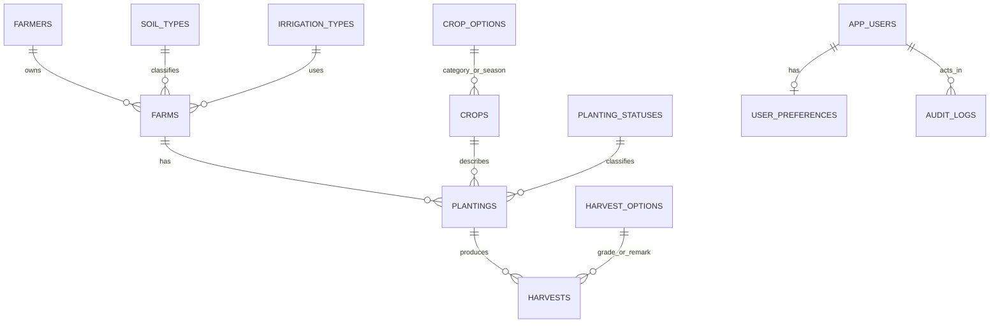

# Agriculture Information System

## 1. Project title and description

**Project title:** Agriculture Information System (AIS)

AIS is a server-rendered web application for maintaining agriculture records. Authorized staff manage farmers, farms, crops, planting activity, and harvests. The application uses PHP 8.3 with PDO for server-side processing, HTML/CSS and small JavaScript enhancements for its interface, and Supabase PostgreSQL for persistent storage. It includes Administrator and Staff accounts, a dashboard, reports, lookup management, and an activity log.

The public web document root is `public/`. Database credentials are supplied through the hosting environment and are not intended to be placed in browser code or committed to Git.

## 2. Project objectives

- Keep farmer, farm, crop, planting, and harvest information in one consistent system.
- Connect related information so users can see the farmer, farm, crop, and status labels instead of only database IDs.
- Validate submitted data in PHP and enforce important integrity rules in PostgreSQL.
- Provide dashboard summaries and date-filtered reports for agricultural records.
- Restrict account and lookup administration to Administrators while allowing authorized Staff to perform normal record work.
- Record important account and data changes in an audit log.
- Make the system usable on desktop and smaller screens, with secure deployment over HTTPS.

## 3. Scope and users

| User          | Main permissions                                                                                                 |
| ------------- | ---------------------------------------------------------------------------------------------------------------- |
| Administrator | All staff functions; create/manage accounts and lookup values; view activity history; delete core records.       |
| Staff         | Sign in; view dashboard and reports; create, view, and update farmer, farm, crop, planting, and harvest records. |

The system does not provide public self-registration. The initial Administrator is created through the documented setup process or an authorized database administrator. A first-time account is required to change its temporary password.

## 4. Functional requirements

| ID    | Requirement                                                                                                                   | Implementation                                                          |
| ----- | ----------------------------------------------------------------------------------------------------------------------------- | ----------------------------------------------------------------------- |
| FR-01 | Users can sign in and sign out. Passwords are stored as one-way hashes.                                                       | PHP session authentication and `app_users`.                             |
| FR-02 | Repeated failed sign-ins trigger a temporary account lock.                                                                    | Failed login count and `locked_until`.                                  |
| FR-03 | Administrators can create, enable/disable, and remove user accounts, subject to protection for the last active Administrator. | Accounts page and server-side role checks.                              |
| FR-04 | Authorized users can create, read, and update Farmers, Farms, Crops, Plantings, and Harvests.                                 | Shared CRUD router and module forms/lists.                              |
| FR-05 | Administrators can delete core records after a confirmation that describes dependent records that will also be removed.       | Transactional delete handler; every deleted dependent row is audited.   |
| FR-06 | Users can search module records, use available filters, and navigate paginated results.                                       | Server-side search/filter/pagination with allow-listed SQL sort fields. |
| FR-07 | Forms provide controlled dropdowns for related and reference records. Inactive lookup options cannot be newly selected.       | `app/domain.php`, reference tables, and server validation.              |
| FR-08 | The dashboard displays record counts, planting status, harvest quantity/value, and recent records.                            | Dashboard route and view.                                               |
| FR-09 | Users can view reports and export supported harvest data to CSV.                                                              | Reports route and report view.                                          |
| FR-10 | Administrators can manage lookup labels and review account/data activity.                                                     | Lookups and Activity Log pages.                                         |
| FR-11 | Users can update their profile name, theme, and password.                                                                     | Profile page and `user_preferences`.                                    |
| FR-12 | State-changing forms require a valid CSRF token; output is escaped and database values use PDO parameters.                    | Shared PHP helpers and route handlers.                                  |

## 5. Non-functional requirements

- **Security:** HTTPS in production; secure, HTTP-only session cookies; CSRF protection; server-side role checks; hashed passwords; private environment secrets; prepared statements; and escaped HTML output.
- **Data integrity:** Primary/foreign keys, unique constraints, check constraints, and date-validation triggers protect stored data.
- **Privacy:** The browser does not connect directly to PostgreSQL. Private pages use no-store caching. Audit records store change metadata rather than password values.
- **Compatibility:** PHP 8.2+ with `pdo_pgsql`; PostgreSQL/Supabase; a modern browser.
- **Availability:** Supabase is the persistent database. Render free web services may sleep when idle, so the first request after inactivity may be delayed.
- **Maintainability:** Module definitions, migrations, shared layout, tests, and deployment instructions are kept in separate project files.

## 6. Entity-Relationship Diagram



The `crop_options` and `harvest_options` relationships are two separate foreign keys each, qualified by a type column. That discriminator prevents using a season where a crop category is required or a remark where a quality grade is required. Each user can have zero or one preference row; each audit row has zero or one actor (the actor becomes null if the account is deleted).

## 7. Normalization from UNF through 3NF

The assignment does not provide one original flat table. The following UNF is an illustrative reconstruction of the required information, not a claim that this exact source table was supplied.

### Unnormalized form (UNF)

A spreadsheet could put farmer, farm, crop, planting, and a repeating group of harvest details together:

```text
FARM_ACTIVITY_UNF(
  farmer_id, farmer_name, contact, address,
  farm_id, farm_name, location,
  crop_id, crop_name, variety,
  planting_id, planting_date, area_planted, seed_quantity, status,
  harvest_details=[(date, quantity, price, grade, remark), ...]
)
```

`harvest_details` is a repeating group, and farmer/farm/crop details repeat across related rows.

### First normal form (1NF)

Make every field atomic and represent each harvest as a separate row. Use `(planting_id, harvest_row_no)` as an illustrative composite key:

```text
ACTIVITY_1NF(
  planting_id, harvest_row_no, farmer_id, farmer_name, contact, address,
  farm_id, farm_name, location, crop_id, crop_name, variety,
  planting_date, area_planted, seed_quantity, expected_harvest_date, status,
  harvest_date, quantity_kg, selling_price_per_kg, quality_grade, remark
)
```

Every cell now contains one value. Repeated descriptive values and partial dependencies still exist.

### Second normal form (2NF)

Separate harvest facts from planting facts. In the illustrative composite-key table, planting details depend on `planting_id` alone, not on the full `(planting_id, harvest_row_no)` key:

```text
PLANTING_2NF(planting_id, farm_id, crop_id, planting_date, area_planted,
             seed_quantity, expected_harvest_date, status)
HARVEST_2NF(harvest_id, planting_id, harvest_date, quantity_kg,
            selling_price_per_kg, quality_grade, remark)
```

### Third normal form (3NF)

Separate entities and controlled values into the 13 tables documented below. A non-key attribute is stored with the key it describes, avoiding transitive dependencies such as `planting_id → farm_id → farmer_name`. Lookups store labels once and are referenced by ID. User theme preference is separate from account identity. Within each table, non-key fields depend on the key, the whole key, and nothing but the key.

## 8. Data dictionary

`PK` means primary key; `FK` means foreign key; `NN` means not null. `IDENTITY` means PostgreSQL generates the identifier. Timestamps are database-managed unless otherwise noted. Numeric area and seed units are assignment assumptions displayed as hectares/kilograms; currency is shown as PHP by the application and should be confirmed with the instructor.

### `farmers`

| Column            | Type         | Rules                           | Meaning                |
| ----------------- | ------------ | ------------------------------- | ---------------------- |
| `farmer_id`       | BIGINT       | PK, identity                    | Farmer identifier.     |
| `first_name`      | VARCHAR(50)  | NN, nonblank                    | Given name.            |
| `last_name`       | VARCHAR(50)  | NN, nonblank                    | Family name.           |
| `contact_number`  | VARCHAR(20)  | Nullable, no control characters | Optional contact.      |
| `address`         | VARCHAR(150) | NN, nonblank                    | Farmer address.        |
| `date_registered` | DATE         | NN, defaults to current date    | Registration date.     |
| `created_at`      | TIMESTAMPTZ  | NN, default now                 | Creation timestamp.    |
| `updated_at`      | TIMESTAMPTZ  | NN, default now, update trigger | Last update timestamp. |

### `farms`

| Column                     | Type         | Rules                              | Meaning                    |
| -------------------------- | ------------ | ---------------------------------- | -------------------------- |
| `farm_id`                  | BIGINT       | PK, identity                       | Farm identifier.           |
| `farmer_id`                | BIGINT       | NN, FK → `farmers`                 | Owner.                     |
| `farm_name`                | VARCHAR(100) | NN, nonblank                       | Farm name.                 |
| `location`                 | VARCHAR(150) | NN, nonblank                       | Farm location.             |
| `area_hectares`            | NUMERIC(8,2) | NN, > 0                            | Farm area.                 |
| `soil_type_id`             | SMALLINT     | NN, FK → `soil_types`              | Soil classification.       |
| `irrigation_type_id`       | SMALLINT     | NN, FK → `irrigation_types`        | Irrigation method.         |
| `created_at`, `updated_at` | TIMESTAMPTZ  | NN; update trigger on `updated_at` | Creation and update times. |

Unique rule: `(farmer_id, farm_name)`.

### `crops`

| Column                     | Type        | Rules                              | Meaning                    |
| -------------------------- | ----------- | ---------------------------------- | -------------------------- |
| `crop_id`                  | BIGINT      | PK, identity                       | Crop identifier.           |
| `crop_name`                | VARCHAR(80) | NN, nonblank                       | Crop name.                 |
| `variety`                  | VARCHAR(80) | NN, nonblank                       | Crop variety.              |
| `category_option_id`       | SMALLINT    | NN, composite FK → `crop_options`  | Category option ID.        |
| `category_option_type`     | VARCHAR(20) | NN, default/check `category`       | Category discriminator.    |
| `growing_period_days`      | INTEGER     | NN, >= 1                           | Growing duration.          |
| `season_option_id`         | SMALLINT    | NN, composite FK → `crop_options`  | Recommended season ID.     |
| `season_option_type`       | VARCHAR(20) | NN, default/check `season`         | Season discriminator.      |
| `created_at`, `updated_at` | TIMESTAMPTZ | NN; update trigger on `updated_at` | Creation and update times. |

Unique rule: `(crop_name, variety)`.

### `plantings`

| Column                     | Type         | Rules                              | Meaning                    |
| -------------------------- | ------------ | ---------------------------------- | -------------------------- |
| `planting_id`              | BIGINT       | PK, identity                       | Planting identifier.       |
| `farm_id`                  | BIGINT       | NN, FK → `farms`                   | Farm being planted.        |
| `crop_id`                  | BIGINT       | NN, FK → `crops`                   | Crop being planted.        |
| `planting_date`            | DATE         | NN                                 | Planting date.             |
| `area_planted`             | NUMERIC(8,2) | NN, > 0                            | Area planted.              |
| `seed_quantity`            | NUMERIC(8,2) | NN, >= 0                           | Seed quantity.             |
| `expected_harvest_date`    | DATE         | NN, >= planting date               | Expected harvest date.     |
| `status_id`                | SMALLINT     | NN, FK → `planting_statuses`       | Current status.            |
| `created_at`, `updated_at` | TIMESTAMPTZ  | NN; update trigger on `updated_at` | Creation and update times. |

### `harvests`

| Column                     | Type          | Rules                                  | Meaning                    |
| -------------------------- | ------------- | -------------------------------------- | -------------------------- |
| `harvest_id`               | BIGINT        | PK, identity                           | Harvest identifier.        |
| `planting_id`              | BIGINT        | NN, FK → `plantings`                   | Related planting.          |
| `harvest_date`             | DATE          | NN, on/after planting date via trigger | Date harvested.            |
| `quantity_kg`              | NUMERIC(10,2) | NN, > 0                                | Harvest quantity.          |
| `selling_price_per_kg`     | NUMERIC(10,2) | Nullable, >= 0                         | Optional selling price.    |
| `quality_option_id`        | SMALLINT      | NN, composite FK → `harvest_options`   | Quality grade ID.          |
| `quality_option_type`      | VARCHAR(20)   | NN, default/check `grade`              | Grade discriminator.       |
| `remark_option_id`         | SMALLINT      | NN, composite FK → `harvest_options`   | Harvest remark ID.         |
| `remark_option_type`       | VARCHAR(20)   | NN, default/check `remark`             | Remark discriminator.      |
| `created_at`, `updated_at` | TIMESTAMPTZ   | NN; update trigger on `updated_at`     | Creation and update times. |

### Reference, account, and audit tables

| Table               | Columns and rules                                                                                                                                                                                                                                                                                                                                                                                                                                   | Purpose                                                                                    |
| ------------------- | --------------------------------------------------------------------------------------------------------------------------------------------------------------------------------------------------------------------------------------------------------------------------------------------------------------------------------------------------------------------------------------------------------------------------------------------------- | ------------------------------------------------------------------------------------------ |
| `crop_options`      | `option_id` SMALLINT PK identity; `option_type` VARCHAR(20) NN/check in `category`,`season`; `option_label` VARCHAR(50) NN; `is_active` BOOLEAN NN default true; unique `(option_type, option_label)` and `(option_id, option_type)`.                                                                                                                                                                                                               | Crop categories and seasons.                                                               |
| `soil_types`        | `soil_type_id` SMALLINT PK identity; `soil_type_name` VARCHAR(50) NN unique; `is_active` BOOLEAN NN default true.                                                                                                                                                                                                                                                                                                                                   | Soil lookup values.                                                                        |
| `irrigation_types`  | `irrigation_type_id` SMALLINT PK identity; `irrigation_type_name` VARCHAR(50) NN unique; `is_active` BOOLEAN NN default true.                                                                                                                                                                                                                                                                                                                       | Irrigation lookup values.                                                                  |
| `planting_statuses` | `status_id` SMALLINT PK identity; `status_name` VARCHAR(30) NN unique; `is_active` BOOLEAN NN default true.                                                                                                                                                                                                                                                                                                                                         | Planting workflow statuses.                                                                |
| `harvest_options`   | `option_id` SMALLINT PK identity; `option_type` VARCHAR(20) NN/check in `grade`,`remark`; `option_label` VARCHAR(100) NN; `is_active` BOOLEAN NN default true; unique `(option_type, option_label)` and `(option_id, option_type)`.                                                                                                                                                                                                                 | Harvest grades and remarks. Remark IDs 1–5 are seeded to the assignment's required labels. |
| `app_users`         | `user_id` BIGINT PK identity; `full_name` VARCHAR(100) NN/nonblank; `email` VARCHAR(254) NN/unique case-insensitively; `password_hash` VARCHAR(255) NN; `role` VARCHAR(20) NN/check Administrator or Staff; `is_active` BOOLEAN NN default true; `must_change_password` BOOLEAN NN default false; `failed_login_count` INTEGER NN/default 0/check >=0; nullable `locked_until`, `last_login_at`; NN `created_at`, `updated_at` with update trigger. | Staff account, authorization, and sign-in state.                                           |
| `user_preferences`  | `user_id` BIGINT PK and FK → `app_users` with `ON DELETE CASCADE`; `theme` VARCHAR(10) NN/default light/check light or dark; `updated_at` TIMESTAMPTZ NN/default now with update trigger.                                                                                                                                                                                                                                                           | One-to-one theme preference.                                                               |
| `audit_logs`        | `log_id` BIGINT PK identity; nullable `actor_user_id` FK → `app_users` with `ON DELETE SET NULL`; `action` VARCHAR(20) NN/check allowed action list; `entity_table` VARCHAR(63) NN; nullable `record_pk` TEXT, `old_values` JSONB, `new_values` JSONB; `created_at` TIMESTAMPTZ NN/default now.                                                                                                                                                     | Account and record activity history. Password values are not recorded.                     |

## 9. Table relationships and constraints

| Parent                      | Child           | Cardinality               | Delete behavior                                                                                                      |
| --------------------------- | --------------- | ------------------------- | -------------------------------------------------------------------------------------------------------------------- |
| Farmer                      | Farm            | 1 to many                 | Application deletes dependent harvests, plantings, then farms in a confirmed transaction before deleting the farmer. |
| Farm                        | Planting        | 1 to many                 | Application deletes dependent harvests and plantings in a confirmed transaction before deleting the farm.            |
| Crop                        | Planting        | 1 to many                 | Application deletes dependent harvests and plantings in a confirmed transaction before deleting the crop.            |
| Planting status             | Planting        | 1 to many                 | Lookup deletion is restricted; deactivate the lookup instead.                                                        |
| Soil type / Irrigation type | Farm            | 1 to many                 | Lookup deletion is restricted; deactivate the lookup instead.                                                        |
| Crop option                 | Crop            | Two typed 1-to-many links | Restrict deletion while referenced; deactivate the lookup instead.                                                   |
| Planting                    | Harvest         | 1 to many                 | Application deletes dependent harvests in the confirmed planting-delete transaction.                                 |
| Harvest option              | Harvest         | Two typed 1-to-many links | Restrict deletion while referenced; deactivate the lookup instead.                                                   |
| App user                    | User preference | 1 to zero-or-one          | Preference cascades with account deletion.                                                                           |
| App user                    | Audit log       | 1 to many                 | Audit remains; actor ID is set null when account is deleted.                                                         |

The schema uses generated primary keys, foreign keys, uniqueness checks, domain checks, and date triggers. SQL deletion constraints remain restrictive; the application explicitly removes dependent business rows in dependency order, in a database transaction, and writes audit entries for them. A failed delete rolls back the entire operation.

## 10. Screenshots of the working system

No successful end-to-end screenshots are included yet. The screenshots available during documentation preparation show the deployed login and module interface, but the login screenshot displays a database connection error and the earlier farm screenshot displays a delete error. They are not evidence of a fully working system and should not be presented as successful acceptance evidence.

After the deployed database connection and sign-in work, capture genuine screenshots from the live application and add them under `docs/screenshots/`. Recommended evidence:

1. Login and successful landing on the dashboard.
2. Dashboard showing current database summaries.
3. Each core module list and one detail view.
4. Create, edit, and delete confirmation/result for a record using safe demo data.
5. Reports and a CSV export result.
6. Administrator account/lookup/activity pages and the Staff permission boundary.
7. Mobile or narrow-screen layout.

Use synthetic data or redact personal contact details. Do not include passwords, database credentials, secret-file contents, or session tokens in screenshots.

## 11. Testing results

The current result record is detailed in [`test-plan.md`](test-plan.md). At documentation time, static/source checks listed there passed. Database-dependent acceptance tests have not all been completed. The live Render login attempt currently fails before authentication because PHP cannot read the Supabase root certificate at `/etc/secrets/prod-ca-2021.crt`. This is a deployment configuration/permission failure, not a confirmed rejection of the supplied account credentials. Re-run and record the authentication, CRUD, reporting, authorization, and screenshot checks after resolving the certificate read error.

Do not mark any unexecuted test as passed. Record date, environment, test data used, expected result, actual result, and evidence for each dynamic test.

## 12. User guide / basic operating instructions

### Sign in and profile

1. Open the Render URL over HTTPS and sign in with an enabled account.
2. For a temporary first-use account, choose a new password when prompted.
3. Open **My profile** to change the display name, password, or light/dark theme.
4. Use **Sign out** when finished, especially on a shared device.

### Manage agriculture records

1. Use the left navigation to open Farmers, Farms, Crops, Plantings, or Harvests.
2. Select **Add** to create a record. Complete required fields and select related values from the dropdowns.
3. Use **View** to inspect a saved record and **Edit** to change it.
4. Use search, available filters, and pagination to find records.
5. Administrators can select **Delete**. Read the confirmation carefully: deleting a farmer, farm, crop, or planting also removes its dependent plantings/harvests. Lookup values used by records should be deactivated, not removed.

### Dashboard, reports, and administration

- **Overview** summarizes current records and recent planting/harvest activity.
- **Reports** provides report views and CSV export. Check date filters before exporting.
- Administrators use **Accounts** to manage staff accounts, **Lookup values** to maintain controlled choices, and **Activity log** to review recorded changes.
- Staff do not have Administrator-only account, lookup, activity, or delete permissions.

### If something goes wrong

- If sign-in reports a database connection error, report it to the system maintainer; do not retry repeatedly. Check Render service logs and certificate/connection configuration.
- If a save fails validation, correct the highlighted/mentioned value and submit again.
- If a dropdown value is no longer active, refresh the page and choose an active option.
- Do not share passwords, SQL hashes, `.env` files, database credentials, or Render secret-file contents.

## 13. Deployment and maintenance

The project is deployed as a Docker web service on Render and stores persistent application data in Supabase PostgreSQL. Apply the database migration once to the intended Supabase project; do not apply it repeatedly to a populated database. Configure the restricted database user, TLS certificate secret file, and environment variables in Render. Full instructions are in [`deployment.md`](deployment.md). Keep backups and test restores outside the production system.

## 14. Supporting project documents

- [`system-design.md`](system-design.md): requirement mapping and design rationale.
- [`test-plan.md`](test-plan.md): verification plan and execution record.
- [`deployment.md`](deployment.md): Supabase and Render deployment setup.
